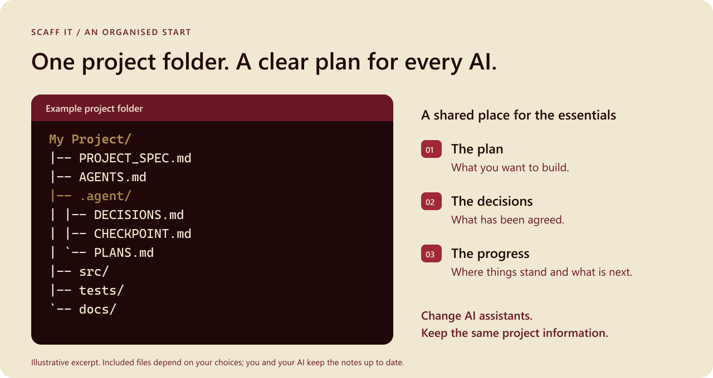

<p align="center">
  <picture>
    <source media="(prefers-color-scheme: dark)" srcset="assets/scaff-it-logo-dark.png">
    <source media="(prefers-color-scheme: light)" srcset="assets/scaff-it-logo-light.png">
    
  </picture>
</p>

<p align="center">
  One project folder. A clear plan for every AI.<br>
  Set up your project. Start building.
</p>

<p align="center">
  <a href="docs/user/README.md"><strong>User guide</strong></a>
  &middot;
  <a href="https://github.com/asrulnasirudin/scaff-it/releases/latest">Download for Windows</a>
  &middot;
  <a href="#quick-start">Quick start</a>
  &middot;
  <a href="#features">Features</a>
  &middot;
  <a href="#development">Development</a>
  &middot;
  <a href="#documentation">Documentation</a>
</p>

<p align="center"><strong>Windows · Works locally · Initial public release 0.1.0</strong></p>

---

Scaff It helps people building with AI start with an organised project folder.
Keep the plan, decisions, and progress in one shared place, so whichever AI assistant
you use has the same information to work from. Start a new project or add missing
folders and guidance files to one you already have.

**Existing-project setup keeps your current files.** Review the proposed additions
before creating them. Scaff It does not move your code or change your existing Git history.



_Illustrative excerpt of a project folder. Included files depend on your choices.
You and your AI assistants keep the project notes up to date and use them as you work._

## Contents

- [Features](#features)
- [Quick start](#quick-start)
- [Development](#development)
- [Project layout](#project-layout)
- [Documentation](#documentation)
- [Feedback](#feedback)
- [Status and terms](#status-and-terms)

## Features

| Workflow | What you can do |
| --- | --- |
| Start organised | Create a project folder with places for your code, checks, guides, and requirements. |
| Keep a shared plan | Give your AI assistants a common place to read the plan, decisions, progress, and next steps. |
| Choose your tools | Answer guided questions about your project and AI assistants, or leave supported choices undecided. |
| Continue an existing project | Add missing folders and guidance files while keeping existing files and history. |
| Review before creating | Preview the proposed files, change your answers, or cancel before anything is written. |
| Add code checks by choice | Set up Python or JavaScript code checks, with separate approval before downloading tools. |
| Keep local change history | Optionally start Git for a new project. Saving a first commit is a separate choice. |

Scaff It prepares the project structure; it does not generate a finished application
or automatically keep AI assistants in sync. See the [user guide](docs/user/README.md)
for the full workflow and supported choices.

## Quick start

### For Windows users

1. Download **Scaff-It-Windows.zip** from [Releases](https://github.com/asrulnasirudin/scaff-it/releases/latest).
2. Extract the entire ZIP into a writable folder.
3. Open **Scaff It.exe** and choose an action.
4. Choose your project folder and answer the guided questions.
5. Review the proposed files, then approve creation when you are ready.

Keep the **_internal** folder beside the executable. The portable app includes
Python, folder browsing, templates, and the Python code checker; you do not need to
install Python or use an administrator installer to run it. The app is unsigned,
so Windows may show a publisher warning. A SHA-256 checksum accompanies the download.

The [user guide](docs/user/README.md) covers setup, existing projects, optional code
checks, and advanced commands. Projects you create need their own development tools.

### For developers

From the repository folder on Windows, with **Python 3.11 or newer**:

```powershell
python src/project_scaffolder.py
```

You can also double-click **Scaff It.cmd**. Runtime code uses Python's standard
library; there are no runtime packages to install for the source launcher.

For the direct command-line interface:

```powershell
python src/new_project.py --help
```

Git is optional. Node.js/npm is needed only for optional JavaScript tooling.
See the [developer guide](docs/developer/README.md) for build requirements and
portable Windows package verification.

## Development

| Command | Purpose |
| --- | --- |
| `python src/project_scaffolder.py` | Open the complete guided menu. |
| `python src/new_project.py --help` | Show command-line options and examples. |
| `python -m ruff check .` | Check Python code with Ruff. |
| `python -m unittest discover -s tests -v` | Run regression tests. |
| `python .agent/check.py` | Check project readiness. |
| `python .agent/safety_check.py` | Check candidate and staged files for repository safety issues. |
| `git diff --check` | Check changed files for whitespace errors. |

To install the pinned development checker when you choose to:

```powershell
python -m pip install -r requirements-dev.txt
```

GitHub Actions runs lint, tests, readiness, safety, and whitespace checks. The Windows
link test skips when the required permissions are unavailable; review skipped tests
before reporting validation as complete.

Before contributing, read [AGENTS.md](AGENTS.md) and the
[current checkpoint](.agent/CHECKPOINT.md). Build and packaging instructions are in
the [developer guide](docs/developer/README.md).

## Project layout

```text
src/
  scaffolder/      Guided setup, project creation, checks, and terminal styling
  layers/          Project profiles and supported choices
  templates/       Files used to create project documentation and AI guidance
tests/             Regression tests
tools/             Windows packaging tools
assets/            Selected public logos and README preview
docs/              User and developer guides
.agent/            Shared project context, decisions, plans, and validation
local/             Ignored working material; only its README is tracked
```

## Documentation

| Guide | What it covers |
| --- | --- |
| [User guide](docs/user/README.md) | Setup, guided choices, existing projects, and optional code checks. |
| [Product specification](PROJECT_SPEC.md) | Product purpose, supported behaviour, and boundaries. |
| [Developer guide](docs/developer/README.md) | Source layout, validation, and Windows packaging. |
| [Brand guide](docs/developer/BRANDING.md) | Selected logo, colours, and plain-language messaging. |
| [Publication guidance](docs/developer/PUBLICATION.md) | What belongs in GitHub and what stays local. |
| [Security scope](docs/developer/SECURITY_AUDIT.md) | Safety checks, their limits, and open validation work. |
| [Current checkpoint](.agent/CHECKPOINT.md) | Current source status and remaining limitations. |
| [Changelog](CHANGELOG.md) | Recorded product changes. |

## Feedback

[Open an issue](https://github.com/asrulnasirudin/scaff-it/issues) with what you were
trying to do, what you expected, and what happened. Include your Scaff It version
and Windows version. Review screenshots and output before sharing them; leave out
credentials, private project details, and personal file paths.

For security reports, follow [SECURITY.md](SECURITY.md).

## Status and terms

**Current public download: 0.1.0, unsigned portable Windows x64 app.** The repository
includes newer branding and terminal colours under [Unreleased](CHANGELOG.md#unreleased);
these source changes do not replace the existing download.

Clean Windows profile/VM and real link/junction acceptance remain open. See
[security scope](docs/developer/SECURITY_AUDIT.md) and the
[current checkpoint](.agent/CHECKPOINT.md) for validation limits.

Scaff It is licensed under **MIT**, copyright 2026 Kriio Works. See [LICENSE](LICENSE).
Bundled components retain their own notices in the portable package. Projects you
create need their own licensing decisions.
